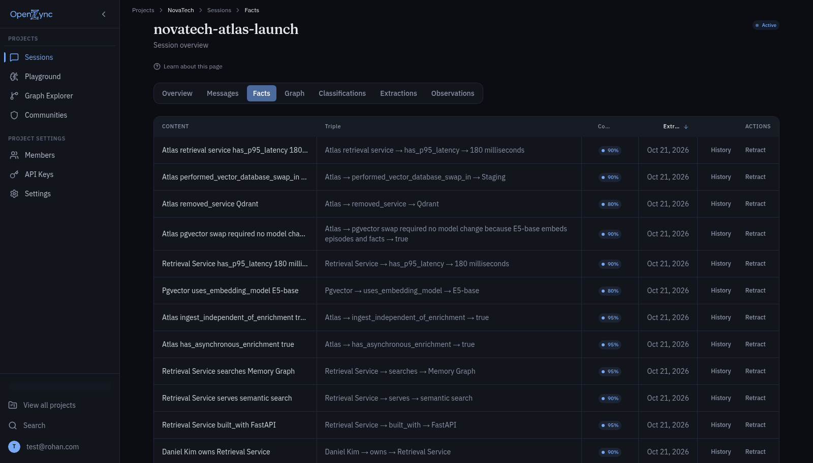
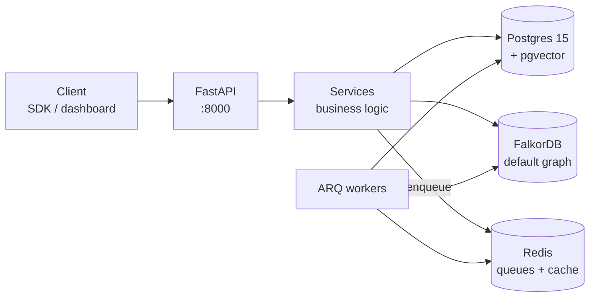

<p align="center"></p>

# OpenZync Core

**Graph memory that survives production.** Self-hosted FastAPI backend, ARQ workers, graph storage.

<p align="center">
  <a href="./LICENSE"></a>
  <a href="https://github.com/openzync/openzync-core/actions/workflows/ci.yml"></a>
  
  
  
</p>

The backend of the OpenZync platform: the open-source temporal knowledge graph where facts supersede
instead of overwriting, with hybrid retrieval over PostgreSQL, FalkorDB and SurrealDB, five LLM
providers, an MCP server and a typed Python SDK. Self-hosted, no vendor lock-in.

[Docs](https://docs.openzync.tech/en/latest/) · [Quickstart guide](https://docs.openzync.tech/en/latest/guides/quickstart.html) · [Live app](https://app.openzync.tech) · [Python SDK](https://pypi.org/project/openzync/) · [GitHub org](https://github.com/openzync) · [Contact](mailto:rohnsha0@gmail.com)

## Features

- **Hybrid retrieval** — vector similarity, BM25 full-text and graph traversal, fused into one ranked list. [Memory and context](https://docs.openzync.tech/en/latest/domains/memory_context.html)
- **Async enrichment** — ARQ workers extract entities, facts, embeddings and classifications off the request path. [Workers](https://docs.openzync.tech/en/latest/domains/workers.html)
- **Five LLM providers** — Ollama, OpenAI, Azure OpenAI, Anthropic and OpenRouter, with keys per organisation. [LLM](https://docs.openzync.tech/en/latest/domains/llm.html)
- **Three graph backends** — FalkorDB is the default, SurrealDB is supported, and the PostgreSQL-native backend is deprecated (removed in v1.1.0). [Graph backends](https://docs.openzync.tech/en/latest/domains/graph_backends.html)
- **Multi-tenant by construction** — org-scoped isolation, JWT and API keys sharing one permission vocabulary. [Auth](https://docs.openzync.tech/en/latest/domains/auth.html)
- **MCP server** — the same memory exposed as tools to Claude Desktop, Cursor and any MCP client. [MCP server](https://docs.openzync.tech/en/latest/domains/mcp_server.html)
- **Observable by default** — Prometheus metrics, structlog JSON logs, Grafana dashboards. [Infrastructure](https://docs.openzync.tech/en/latest/domains/infrastructure.html)

## Benchmark

| Category | Accuracy |
|---|---|
| Overall (500 questions) | **87.1 %** (436/500) |
| Temporal reasoning | 100 % (133/133) |
| Knowledge update | 100 % (78/78) |
| Single-session, assistant | 100 % (56/56) |
| Single-session, user | 92.9 % (65/70) |
| Multi-session | 66.9 % (89/133) |
| Single-session, preference | 50.0 % (15/30) |
| Retrieval R@1 / R@5 / R@10 | 0.816 / 0.834 / 0.840 |

<sub>LongMemEval-S, 500 questions, run 2026-10-10 at commit `9e2fd5e`; judge `nvidia/nemotron-3-ultra-550b` (temperature 0); reranker disabled; zero judge errors. Reproduce with [`benchmarks/run_longmemeval.py`](https://github.com/openzync/openzync-core/blob/master/benchmarks/run_longmemeval.py). This run predates the v1.0.0 tag.</sub>

<p align="center"></p>
*Graph Explorer: 31 nodes and 70 edges extracted from one ingested conversation.*

<p align="center"></p>
*Facts as subject → predicate → object, with confidence and the Retract action.*

## Why OpenZync

**Facts supersede; they do not overwrite.** A contradicting fact marks the old one superseded and
links it to its replacement, so `facts.history()` returns the whole chain and `facts.retract()`
withdraws a claim without destroying the audit trail —
[ADR-005](https://github.com/openzync/openzync-docs/blob/main/adr/005-fact-supersession.md).

**One query, three indexes.** Vector similarity, BM25 and graph BFS return separate ranked lists,
fused with reciprocal rank fusion, so an entity name and a paraphrase both land —
[memory and context](https://docs.openzync.tech/en/latest/domains/memory_context.html).

**Configuration cannot drift from a stale `.env`.** OpenBao is the only source of runtime config:
`.env` holds four bootstrap secrets, everything else is generated into OpenBao's `system` secret and
rendered by the Agent sidecar at startup. No fallback path exists, by design —
[deployment guide](https://docs.openzync.tech/en/latest/guides/deployment.html).

## Quick start

Prerequisites: Docker, Docker Compose v2, ~3 GB free disk.

```bash
git clone https://github.com/openzync/openzync-core.git
cd openzync-core
cp .env.example .env
# Fill the four <replace-with-…> placeholders, generating values with:
#   openssl rand -hex 32                                            → BAO_STATIC_SEAL_KEY
#   openssl rand -base64 32                                         → POSTGRES_PASSWORD
#   python3 -c 'import secrets; print(secrets.token_urlsafe(48))'   → OZ_SECRET_KEY
#   python3 -c 'import secrets; print(secrets.token_urlsafe(32))'   → OZ_WEBHOOK_SIGNING_SECRET

make docker-up-local   # OpenBao, Postgres, FalkorDB, Redis, api and worker

curl -s localhost:8000/health   # {"status":"ok","service":"openzync-api","version":"1.0.0"}
curl -s localhost:8000/ready    # {"status":"ok","checks":{"database":true,"redis":true,"embeddings":true}}
```

Create your account in the [dashboard](https://app.openzync.tech), or `POST /v1/auth/signup` here
with SMTP configured — the OTP is emailed, never logged. First requests:
[quickstart guide](https://docs.openzync.tech/en/latest/guides/quickstart.html).

Production Compose, Helm and the full config reference: [deployment guide](https://docs.openzync.tech/en/latest/guides/deployment.html).

## How it works



Writes land in Postgres first, workers enrich and sync the graph, reads fuse three indexes. Layers
stay strict — `routers → services → repositories → models` — and async throughout.

**Memory pipeline**

1. **Ingest** — `POST /v1/projects/{project_id}/memory` stores messages as episodes in PostgreSQL.
2. **Enrich** — ARQ workers extract entities, facts and classifications, and generate embeddings.
3. **Graph sync** — entities, relationships and temporal edges are written to the graph backend.
4. **Retrieve** — vector, BM25 and graph BFS results are fused with RRF and assembled into context.
5. **Community detection** — Label Propagation groups entities into communities, nightly or post-sync.

**Permissions**

One vocabulary, enforced identically for JWT users and API keys by `require_permission`
([ADR-007](https://github.com/openzync/openzync-docs/blob/main/adr/007-unified-org-permission-model.rst)).
An empty array means all permissions (org `admin`, platform `superadmin`); new members get
`project:read` and `project:write`. Roles live in the DB, cached 60 s in Redis, fail closed.

| Permission | Grants |
|---|---|
| `project:read` | Read projects, memory, context, search and graph data |
| `project:write` | Write project data — ingest, sessions, facts |
| `project:manage` | Project lifecycle: create, archive, delete, settings |
| `configuration:read` | Read org and project configuration |
| `configuration:write` | Modify org and project configuration |
| `members:read` | List org and project members |
| `members:write` | Add or remove members, change their permissions |

## Development

```bash
make dev       # preflight services (OpenBao, Postgres, FalkorDB, Redis, Mailpit), then uvicorn --reload
make test      # unit tests only — no I/O
make test-all  # unit + integration + security + e2e
make lint      # ruff check + ruff format --check
make migrate   # alembic upgrade head
```

Contributions welcome — read the [contributing guide](https://docs.openzync.tech/en/latest/guides/contributing.html).

## License

AGPL-3.0 — see [LICENSE](./LICENSE). Commercial licence for SaaS deployments that cannot release
their modifications: `rohnsha0@gmail.com`. If OpenZync is useful to you, a star helps others find it.
